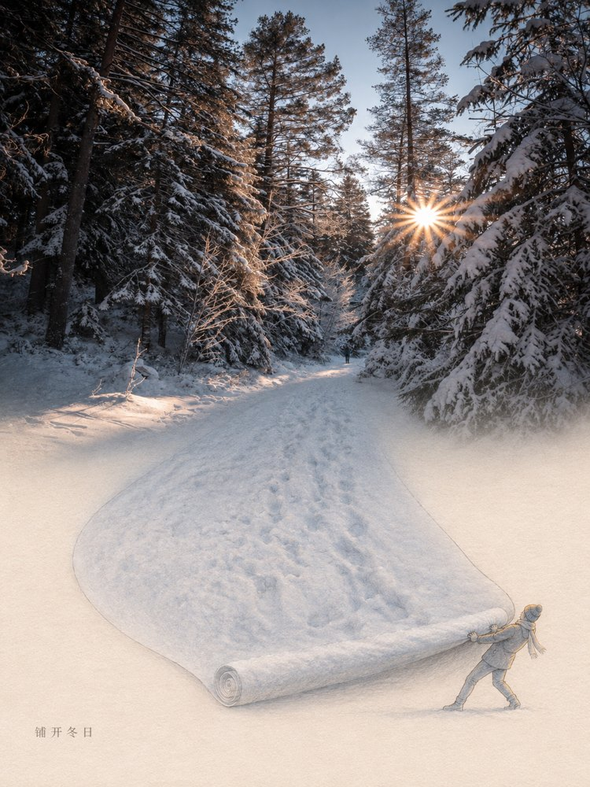
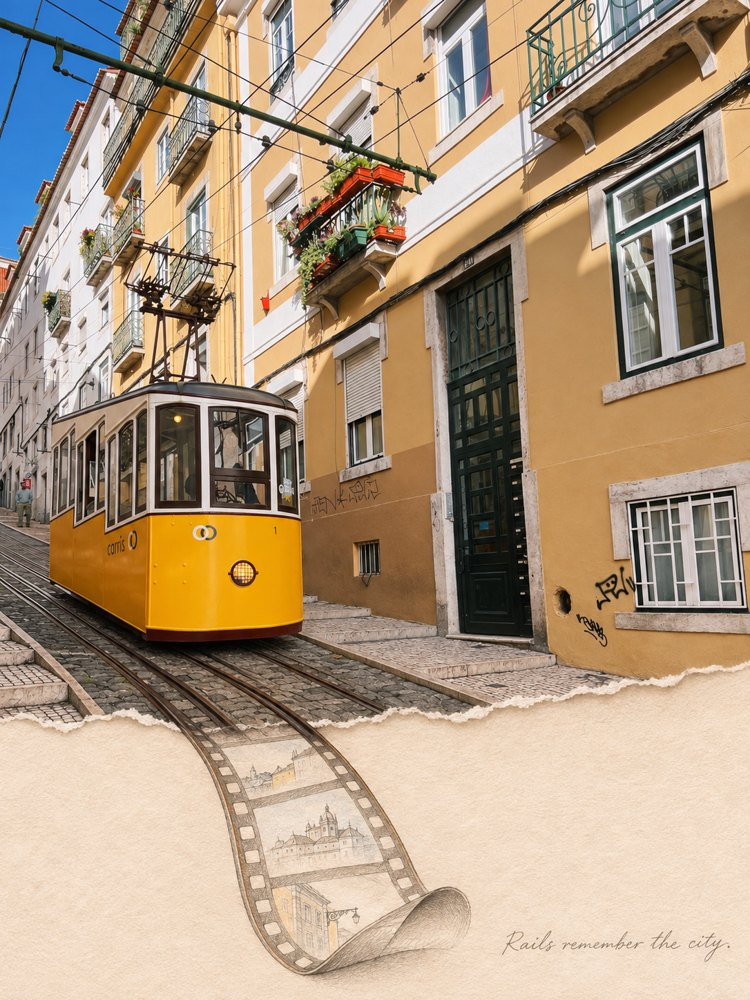
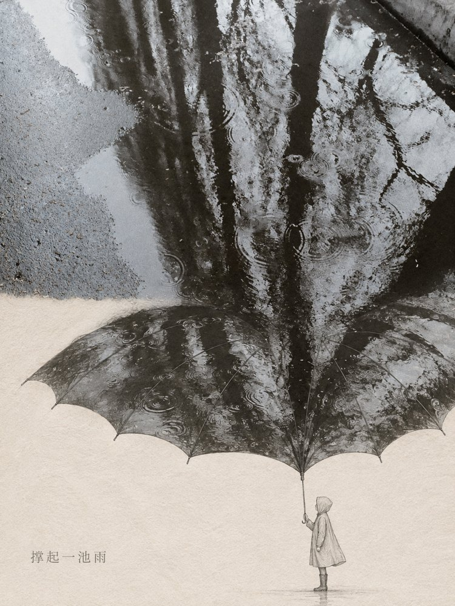
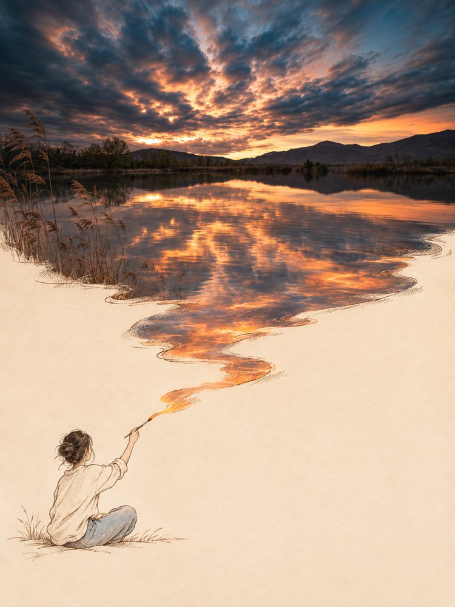
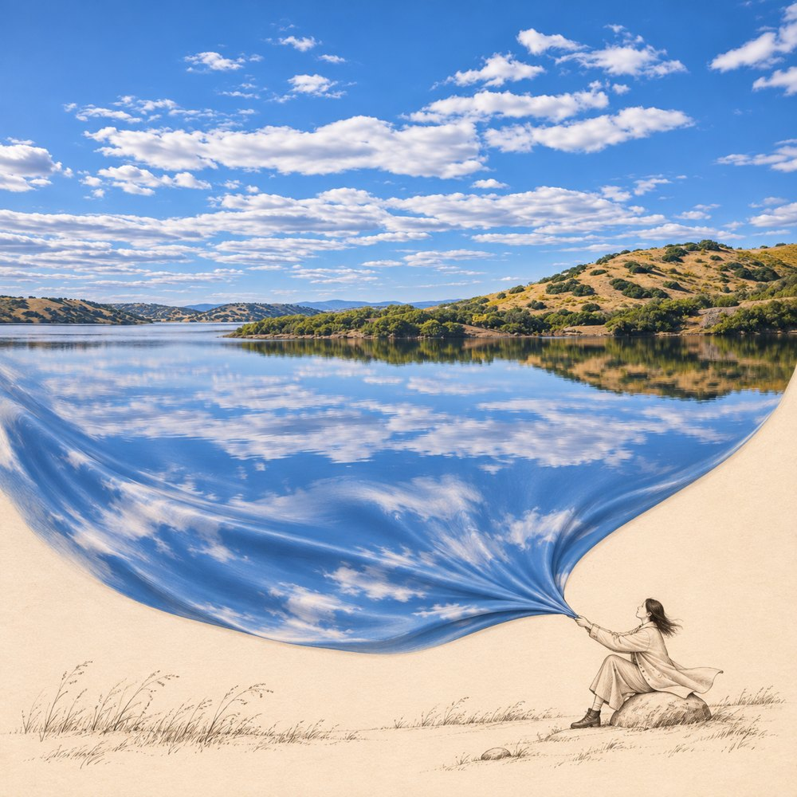
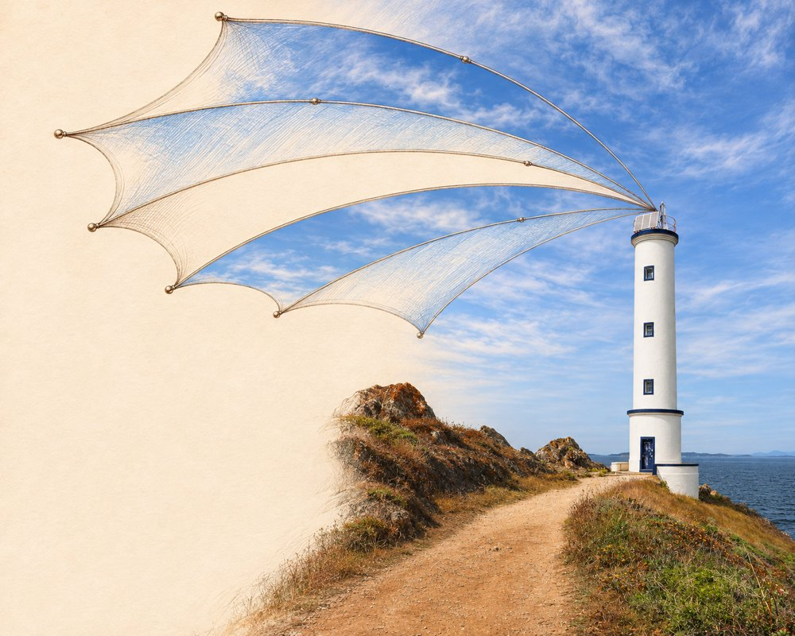
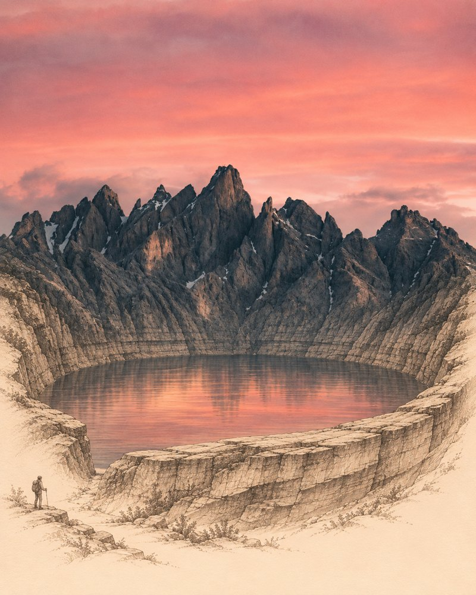
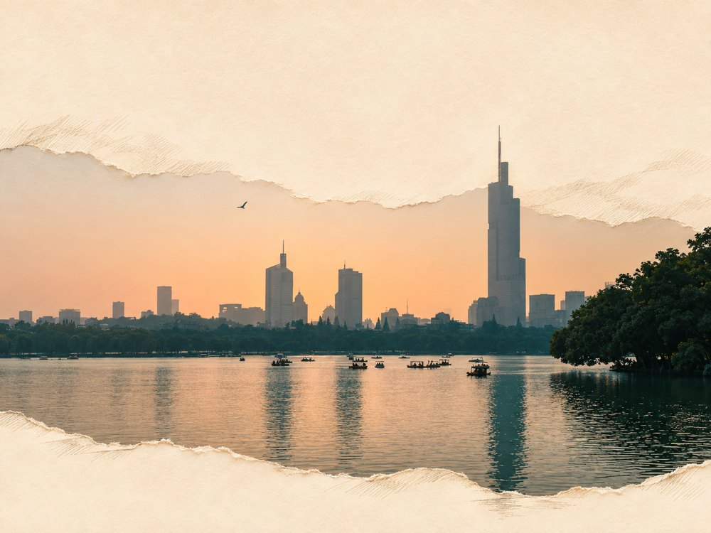

# 实景入纸

把用户上传的任意一张照片制作成“一半真实照片、一半纸上手绘”的拼贴海报。Skill 会先从照片中挑出光、水、天空、轮廓或纹理，再让它自然延伸到暖米白纸面，成为一个和原场景有关的动作或物件。

风景、街景、建筑、人像、宠物、美食、室内都能用。只上传照片、不额外描述时，Skill 会为这张照片单独构思并直接出图。

## 实测：随手上传一张照片

以下三张都是只上传原照、只说一句“用实景入纸把这张照片做成一张拼贴海报，直接出图”得到的（GPT 图像生成）：

| 雪林小路 → 被人卷起的雪毯 | 电车街巷 → 铁轨展开成胶片 | 雨后积水 → 倒影撑成一把伞 |
| --- | --- | --- |
|  |  |  |

## 三种接法

- **人物动手**：纸上的小人物对借来的东西做一个动作，比如把倒影画成颜料、把湖面像布一样揭起来。
- **景物成器**：借来的东西变成一个物件，挂在、撑在、盛在照片里的真实支点上，比如海光做的帆、天空做的伞、岩层围成的石盏。
- **实景成窗**：照片本身成为纸上的一扇撕开的窗、一页翻起的纸。

| 人物动手 | 人物动手 | 景物成器 |
| --- | --- | --- |
|  |  |  |
| **景物成器** | **景物成器** | **实景成窗** |
|  |  |  |

示例只是说明效果，你的照片会得到为它单独构思的画面。

## 文件

- `SKILL.md`：Skill 的完整规则、构思流程、提示词模板与成图检查表。
- `dist/photo-to-paper-collage.zip`：豆包等应用用的安装包。
- `examples/`：效果示例。

## 使用

**豆包电脑版**：打开「技能」→ 右上角「添加」→「上传技能」，选择 [dist/photo-to-paper-collage.zip](dist/photo-to-paper-collage.zip)。装好后在「工作」模式里选上这个技能，上传照片，发一句：

> 用实景入纸把这张照片做成一张拼贴海报，直接出图。

**Codex / Claude Code 等支持 Agent Skills 的应用**：将整个 `photo-to-paper-collage` 文件夹安装为 Skill，或对 AI 助手说：

> 请把这个 GitHub 仓库安装为本地 Skill：https://github.com/lindaifeng/photo-to-paper-collage

想自己控制效果，就在那句话后面补上“让照片里的什么，变成纸上的什么”，例如“让海面的金光变成一张帆”。

## 设计原则

- 保留原照中的真实场景与主要色彩。
- 只选照片中原本存在的一种元素延伸到纸面，优先借整片的面。
- 让纸面上的形状和材质与原景保持联系，变形后的东西是画面主角。
- 以暖米白纸面、克制线稿和留白衬托画面。
- 根据照片内容单独构思，不套用固定构图。

## 说明

- 这个 Skill 只写构思方法和提示词，不包含生图模型。出图效果取决于你用的 AI 工具，同一张照片可以多出几次，挑最好的一张。
- 示例与实测图的底图来自 Pexels 免费图库。请只上传你有权使用的照片。

## 许可

本项目采用 [MIT 许可证](LICENSE)。
